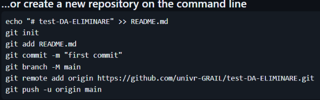
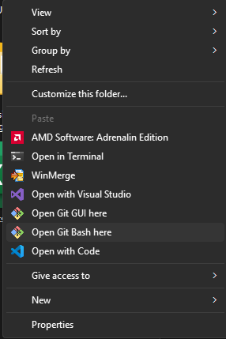
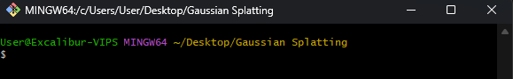
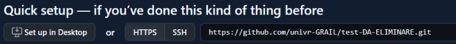

# Git setup

- The moment you start working on your project, upload it our organization's GitHub  
   <https://github.com/univr-GRAIL>
  - Ask an authorized person to create a new repository on the aforementioned organization
  - Ask them to give you access to the repository by telling them your GitHub email address - with **write** permissions
- Follow the instructions you'll find on the newly created repository.
  
   
   
Don't know how to setup and use git? 
Follow the explanation below

## How to
  
- Create a new local repository
 - Navigate to your local project root folder
 - Right click on an empty space in your project root folder-> show more options -> open GIT Bash here
 
   
   
 - Check the yellow path in the command line: make sure is your project root folder
   
   
 - Type the following commands in order:
   
   | cmd                                                                                    | Desc                                                                                                         |
   | -------------------------------------------------------------------------------------- | ------------------------------------------------------------------------------------------------------------ |
   | _git init_                                                                             | Creates a new local repository                                                                               |
   | _git add \*_  alternatively  _git add "local/path/to/your/file/or/folder"_ | Adds all your project files  Adds a single file or folder                                              |
   | _git commit -m "First upload"_                                                         | Commits files with a message  e.g. "First upload"                                                         |
   | _git branch -M main_                                                                   | Change branch to "main"   You'll have to do this only the first time, while setting up the repository |

- Connect the local repository with the remote one  
 You'll have to do this only the first time, while setting up the repository
 
 - Go to the repository GitHub page and copy the _.git_ url  
   e.g.: _<https://github.com/univr-GRAIL/test-DA-ELIMINARE.git>_

   
       
   - In the same command line as before, type:  
         _git remote add origin_ [_https://github.com/univr-GRAIL/test-DA-ELIMINARE.git_](https://github.com/univr-GRAIL/test-DA-ELIMINARE.git)  
         Swapping this URL with the one you just copied
- Push data in the remote repository
    - In the same command line as before, type:  
       _git push -u origin main_

# Git quick commands

Below, command flow typically used while uploading files on git

| cmd                                                                                    | Desc                                                                                                         |
| -------------------------------------------------------------------------------------- | ------------------------------------------------------------------------------------------------------------ |
| _git status_                                                                           | Display status of your files                                    |
| _git add \*_  alternatively  _git add "local/path/to/your/file/or/folder"_ | Adds all your project files  Adds a single file or folder |
| _git commit -m "First upload"_                                                         | Commits files with a message  e.g. "First upload"            |
| _git push_                                                                             | Upload files in the remote repository                           |

