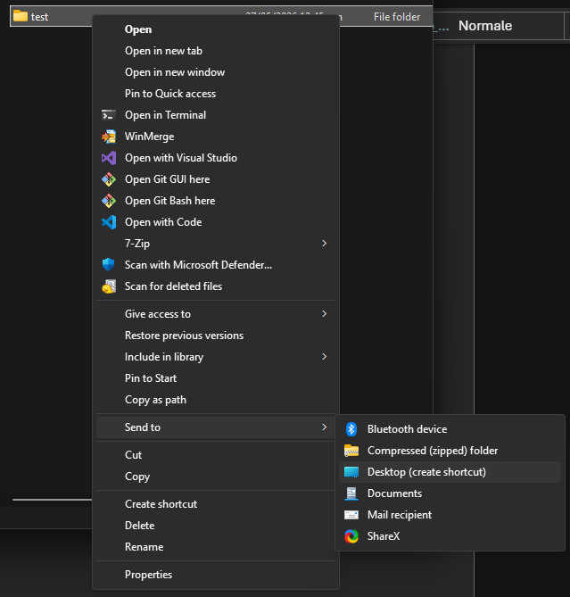

# Windows - Account and internet

- With the help of an authorized person, create a new account on the PC
  - Create a local account only  
     Do not link a Microsoft account
  - **Username**: name and surname (e.g. "John Doe")
  - **Password**: create a personal one
  - The account must be a standard user account - no admin
- Log in to your new account
- Connect to the internet (ethernet) using your GIA credentials - Need help? [Read here](internet.md)
- Open File Explorer and navigate to the shared document folder:  
   C:\\Users\\Public\\Documents
  - Create a new folder, and name it your name and surname (e.g. "John Doe")
  - Right click on the folder -> Show more options
  - Create a new shortcut to desktop:  
     send to -> Desktop (create shortcut)  
     
  - When working, save all your data and your project inside this folder.  
     A shortcut to the folder has now been created on your desktop for easier access
