# Connect to Ethernet

- Open Control Panel

  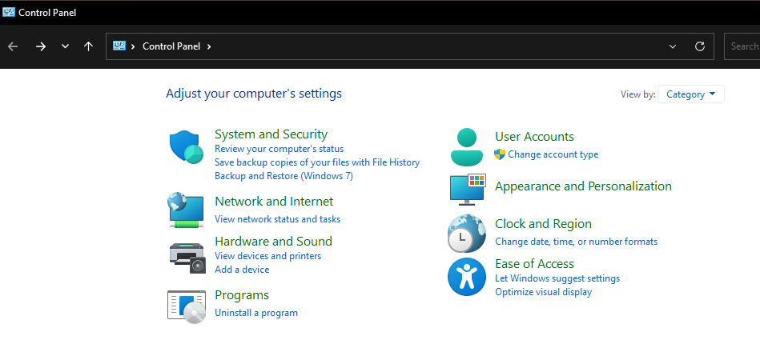

- Network and Internet -> Network and Sharing center
  
  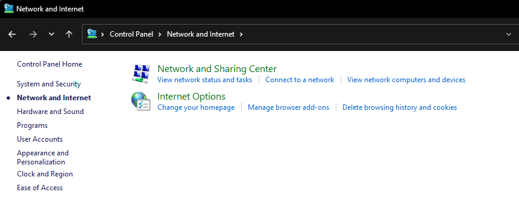

- Click on "Ethernet"
   
   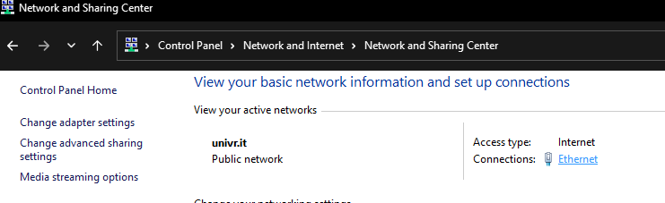
   
- Click on "Properties"  

   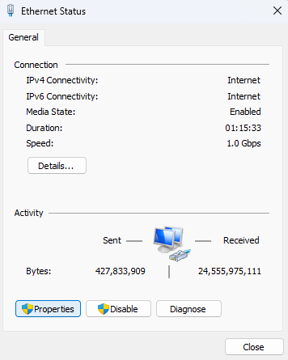
   
- Go to the "Authentication" tab.  
   **Make sure** to match the settings shown in the image  
   Then click on "Settings"
  
   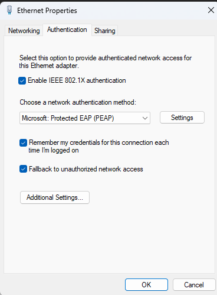
  
- **Make sure** to match the settings shown in the image.  
   Then click on "Configure"

   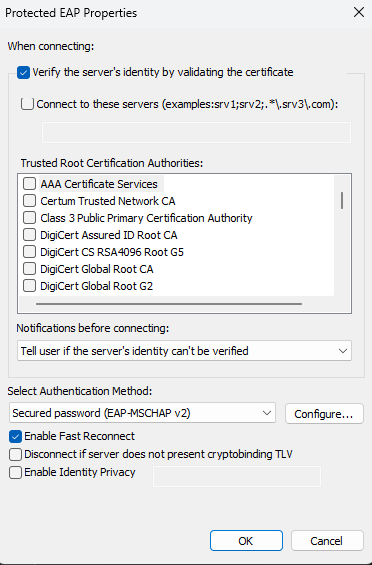

- **Make sure** to match the settings shown in the image.  
   Click OK, so you will return to the previous screen. Click OK again

  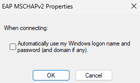
   
- You should now be here again.  
   Click on "Additional Settings..."

   
  
- Make sure to match the settings shown in the image
 
   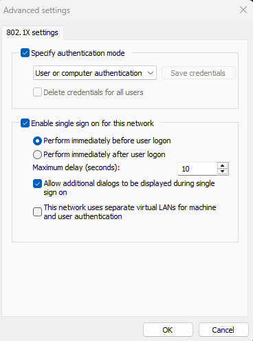
   
- Click "Ok" on all the 3 screens, then a notification pop-up should appear.
  Click "Sign in"
  
   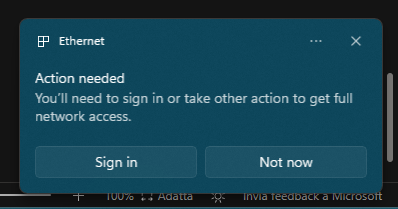
     
- You will be redirected to the settings. Click "Sign in"

   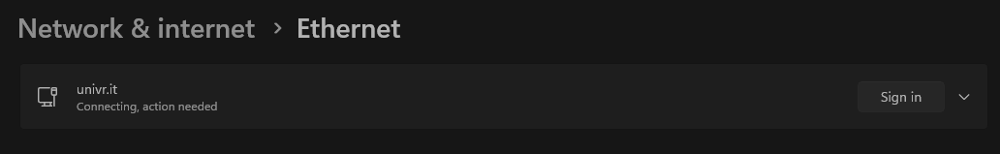
   
- Type your GIA credential in the form of
   _id000aaa_  
   Then click "OK"  

   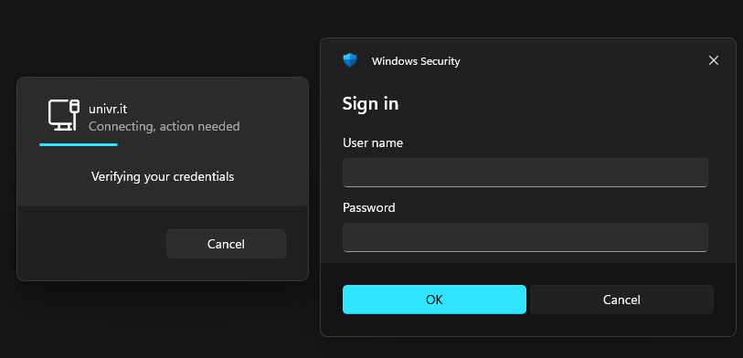
   
- Click "connect"  

   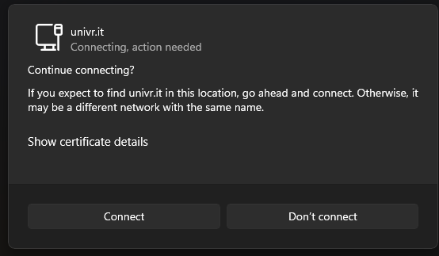
  
- If everything is fine and you are connected, you should see both messages as in the images
  
  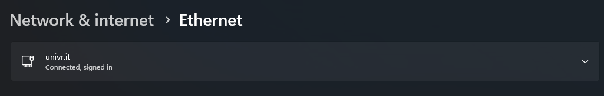
  
  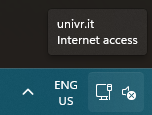
